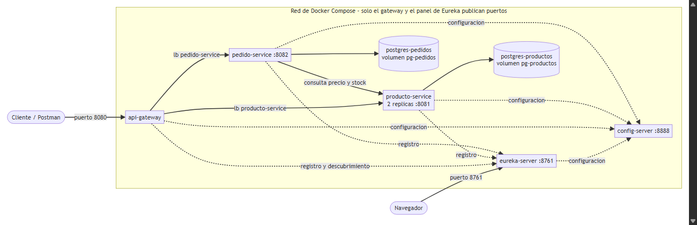
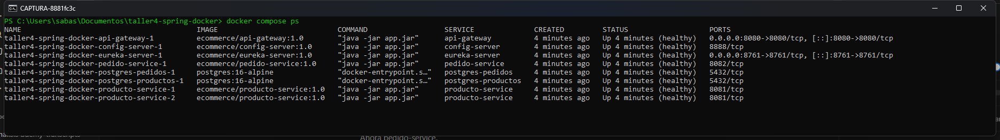
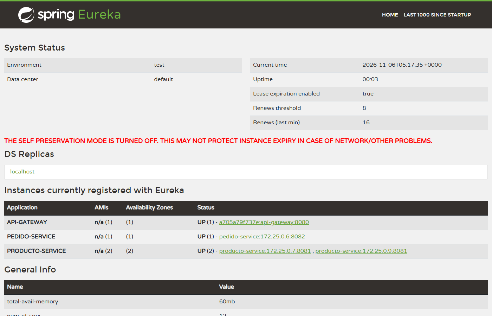

# E-commerce con Spring Boot y Docker (Taller 4)

Ecosistema de microservicios Spring Boot 3.5 / Spring Cloud empaquetado en imágenes Docker y levantado
junto a sus bases de datos PostgreSQL con **un solo comando**:

```bash
docker compose up -d --build
```

Implementa la *Guía de implementación: proyectos Spring Boot con Docker* (Electiva I, Semana 15 / Taller 4),
hasta el Paso 5 (varios microservicios con Eureka y Gateway).

## Arquitectura



Código fuente del diagrama (Mermaid): [`docs/arquitectura.mmd`](docs/arquitectura.mmd).

| Servicio | Puerto interno | Publicado al equipo | Depende de |
|---|---|---|---|
| `postgres-productos` / `postgres-pedidos` | 5432 | No | — |
| `config-server` | 8888 | No | — |
| `eureka-server` | 8761 | **Sí** (panel) | config-server |
| `producto-service` (2 réplicas) | 8081 | No | eureka-server, postgres-productos |
| `pedido-service` | 8082 | No | eureka-server, postgres-pedidos |
| `api-gateway` | 8080 | **Sí** (entrada única) | eureka-server |

Cada servicio sigue la separación `controlador → servicio → repositorio` y expone DTO (`record`) en lugar de
entidades JPA. `pedido-service` consulta el precio y el stock a `producto-service` por su nombre en Eureka
(`http://producto-service`), de modo que el balanceador reparte las llamadas entre las réplicas.

## Requisitos

| Herramienta | Versión | Para qué |
|---|---|---|
| Docker Desktop / Engine | última estable | construir y ejecutar (único requisito para desplegar) |
| Docker Compose | v2 (incluido en Docker Desktop) | orquestación |
| JDK 21 y Maven 3.9 | opcional | solo para compilar/probar fuera de Docker |
| Postman | opcional | probar la colección incluida |

Hardware: 8 GB de RAM como mínimo; con 2 réplicas de `producto-service` conviene 16 GB. En equipos de 8 GB
cambiar `replicas: 2` por `replicas: 1` en `docker-compose.yml`.

## Despliegue

```bash
git clone https://github.com/SebastianMontes-Dev/taller4-spring-docker.git
cd taller4-spring-docker
cp .env.example .env        # en Windows (PowerShell): Copy-Item .env.example .env
# editar .env y cambiar DB_PASSWORD
docker compose up -d --build
docker compose ps           # esperar a que todo esté "healthy" (1-2 minutos)
```

Con todos los contenedores en `healthy`:



Comandos útiles:

| Comando | Para qué sirve |
|---|---|
| `docker compose ps` | Estado y salud de cada contenedor |
| `docker compose logs -f producto-service` | Seguir los logs de un servicio |
| `docker compose up -d --build producto-service` | Reconstruir y reiniciar solo un servicio |
| `docker compose config` | Validar el YAML con las variables ya resueltas |
| `docker stats` | Consumo real de CPU y memoria |
| `docker compose down` | Detener y eliminar contenedores y red (conserva los volúmenes) |
| `docker compose down -v` | Lo anterior y además borra los volúmenes (se pierden los datos) |

Panel de Eureka: <http://localhost:8761> — las dos réplicas de `producto-service`, `pedido-service` y
`api-gateway` deben aparecer registradas.



## Uso (colección Postman)

Importar [`postman/ecommerce-docker.postman_collection.json`](postman/ecommerce-docker.postman_collection.json)
y ejecutarla en orden (la creación del producto guarda su id en `{{productoId}}`). Todo entra por el gateway
(`http://localhost:8080`):

| Método | URL | Descripción |
|---|---|---|
| GET | `/actuator/health` | Salud del gateway |
| POST | `/api/productos` | Crear producto |
| GET | `/api/productos` · `/api/productos/{id}` | Listar / consultar |
| PUT | `/api/productos/{id}` | Actualizar |
| DELETE | `/api/productos/{id}` | Eliminar |
| GET | `/api/productos/instancia` | Réplica que atendió la petición (balanceo) |
| POST | `/api/pedidos` | Crear pedido `{"productoId": 1, "cantidad": 2}` (calcula el total con el precio de producto-service) |
| GET | `/api/pedidos` · `/api/pedidos/{id}` | Listar / consultar |

Ejemplo con curl:

```bash
curl -X POST http://localhost:8080/api/productos -H "Content-Type: application/json" \
     -d '{"nombre":"Teclado mecanico","descripcion":"Switches azules","precio":120000,"stock":10}'
curl -X POST http://localhost:8080/api/pedidos -H "Content-Type: application/json" \
     -d '{"productoId":1,"cantidad":2}'
```

Errores controlados: `400` validación, `404` producto/pedido inexistente, `409` stock insuficiente,
`503` si `producto-service` no está disponible.

## Cumplimiento de la lista de chequeo

| Requisito de la guía | Cómo se cumple |
|---|---|
| Dockerfile multi-stage con `eclipse-temurin:21-jre-alpine` y tag fijo | `*/Dockerfile`: etapas compilar → extraer capas → ejecutar; sin `latest` |
| `.dockerignore` y usuario no root | `*/.dockerignore`; usuario `spring` (`USER spring`) |
| URLs, credenciales y hosts por variables con valor por defecto | `application.yml` con `${DB_URL:…}`, `${CONFIG_SERVER_URL:…}`, `${EUREKA_URL:…}` |
| `/actuator/health` y healthcheck en Compose | Todos los servicios; `wget -qO-` (Alpine no trae `curl`) |
| Orden de arranque con `depends_on` + `service_healthy` | Ver `docker-compose.yml` |
| PostgreSQL con volumen con nombre | `pg-productos`, `pg-pedidos` |
| Credenciales en `.env` no versionado + `.env.example` | `.gitignore` excluye `.env` |
| Solo el Gateway y los paneles publican puertos | 8080 (gateway) y 8761 (panel Eureka) |
| `docker compose ps` todo en `healthy` | Captura arriba |

Más evidencias (imágenes y capas, usuario no root, consumo, balanceo, persistencia, pruebas) en
[`docs/evidencias`](docs/evidencias).

## Estructura

```
taller4-spring-docker/
├── docker-compose.yml
├── .env.example            # plantilla; el .env real no se versiona
├── config-server/          # Spring Cloud Config (perfil native)
├── eureka-server/          # descubrimiento de servicios
├── api-gateway/            # Spring Cloud Gateway (entrada única)
├── producto-service/       # catálogo (JPA + PostgreSQL)
├── pedido-service/         # pedidos (JPA + PostgreSQL + cliente de producto-service)
├── postman/                # colección de ejemplo
└── docs/                   # capturas de evidencia
```

Cada servicio tiene su propio `Dockerfile`, `.dockerignore` y `pom.xml`. Las pruebas unitarias se ejecutan
con `mvn package` dentro de cada carpeta (el Dockerfile compila con `-DskipTests` para acelerar el build).

## Problemas frecuentes

| Síntoma | Causa probable | Solución |
|---|---|---|
| `Connection refused` a `localhost` | Dentro del contenedor `localhost` es el propio contenedor | Usar el nombre del servicio de Compose |
| `port is already allocated` | Un servicio sigue corriendo en local | Detener el proceso local; no publicar puertos en servicios con réplicas |
| `Exited (137)` o reinicios en bucle | Contenedor sin memoria | Revisar `docker stats`; ajustar el límite de memoria |
| Los cambios de código no aparecen | Se reutilizó la imagen anterior | `docker compose up -d --build` |
| Desaparecieron los datos | Se usó `down -v` | Usar `down` sin `-v` |
| El gateway responde `503` justo después de levantar | El registro en Eureka tarda hasta ~30 s en propagarse al gateway | Reintentar pasados unos segundos |
